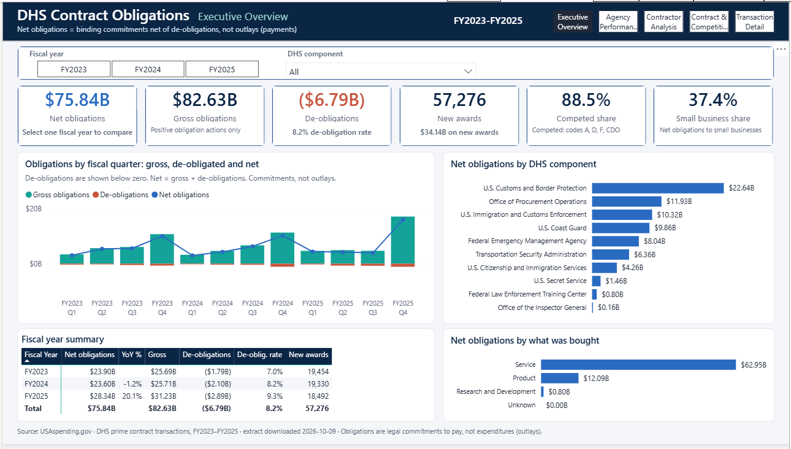
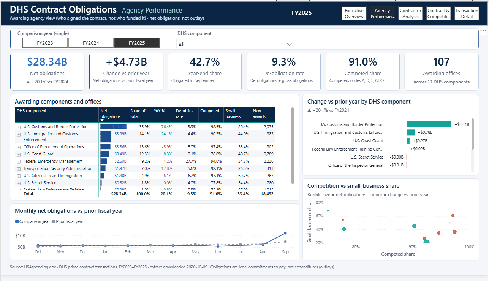
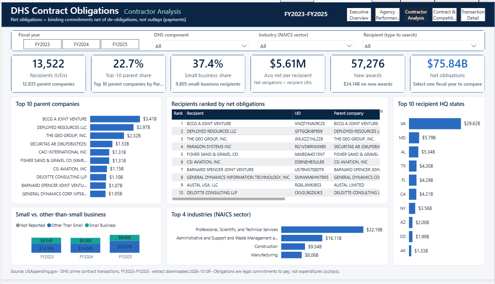
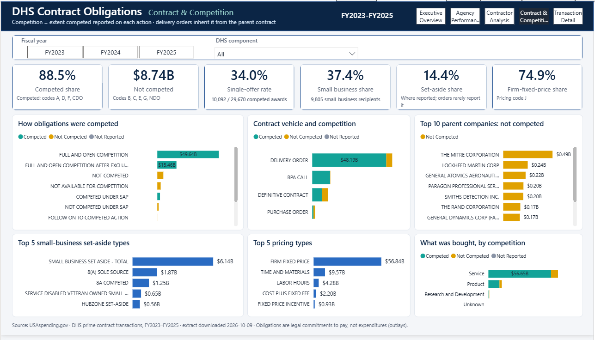
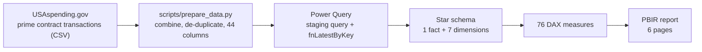
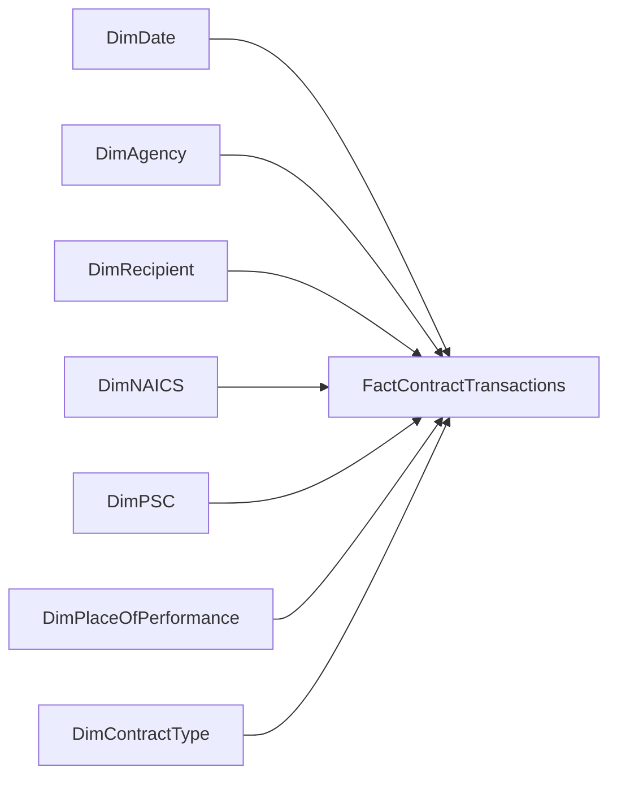

# Federal Spending Analytics: DHS Contract Obligations in Power BI

An end-to-end Power BI portfolio project analysing **$75.84 billion** of U.S. Department of Homeland Security (DHS)
prime contract obligations for federal fiscal years 2023–2025, built from public
[USAspending.gov](https://www.usaspending.gov) data. It covers the full workflow: a reproducible data-preparation
script, a Power Query staging layer, a star-schema semantic model with **76 DAX measures**, and a six-page report.
The project is stored as a Power BI Project (PBIP) with the model in TMDL and the report in PBIR, so every table,
measure and visual is human-readable and version-controlled.

| | |
|---|---|
| Scope | DHS prime contract transactions, action dates 2022-10-01 to 2025-09-30 (FY2023–FY2025) |
| Volume | 169,336 transactions · 85,027 awards · 13,522 recipients |
| Net obligations | **$75.84B** (FY2023 $23.90B · FY2024 $23.60B · FY2025 $28.34B) |
| Model | Star schema: 1 fact table, 7 dimensions, 76 measures |
| Report | 4 analytical pages, a drill-through detail page and a report-page tooltip |
| Format | PBIP · TMDL semantic model · PBIR report |

## Contents

- [Screenshots](#screenshots)
- [Business problem and objectives](#business-problem-and-objectives)
- [Report pages](#report-pages)
- [Data source](#data-source)
- [Technical architecture](#technical-architecture)
- [Reproduce the project](#reproduce-the-project)
- [Semantic model](#semantic-model)
- [Measures and KPIs](#measures-and-kpis)
- [Page design notes](#page-design-notes)
- [Validation and quality assurance](#validation-and-quality-assurance)
- [Interpreting federal obligations and data limitations](#interpreting-federal-obligations-and-data-limitations)
- [AI assistance](#ai-assistance)
- [License](#license)

## Screenshots

Captured from Power BI Desktop with the report's default filters.

### Executive Overview


### Agency Performance


### Contractor Analysis


### Contract & Competition


## Business problem and objectives

DHS is one of the largest federal buyers of goods and services. Public spending data is detailed but hard to read
directly: one contract can generate dozens of transactions, de-obligations reduce earlier commitments, and award
summaries repeat lifetime totals. This project turns the raw transaction file into a model that answers, by fiscal
year and DHS component:

- **How much is obligated, and how is it changing?** Net, gross and de-obligated amounts, year-over-year change and
  the September year-end surge.
- **Which components and offices award the money?** Awarding components and offices, their growth and their mix.
- **Who receives it?** Parent companies and recipients, vendor concentration, industries, headquarters states and
  small-business participation.
- **How is it bought?** Competition, single-offer awards, contract vehicles, pricing types and set-asides.

Design goals: every figure reconciles to values recomputed independently from the source data, de-obligations are
never hidden, and measures stay correct under any combination of filters.

## Report pages

| Page | Questions it answers | Main content |
|---|---|---|
| **Executive Overview** | How much does DHS obligate, and on what? | KPIs (net, gross and de-obligated amounts, new awards, competed and small-business shares) · quarterly gross / de-obligated / net trend · net obligations by DHS component (drill to office) · fiscal-year summary table · obligations by product, service or R&D (drill to product/service code) |
| **Agency Performance** | Which awarding components grew or declined? | Single-select comparison year · KPIs including change vs prior year and year-end (September) share · component → awarding-office matrix with data bars · change vs prior year by component · monthly comparison with the prior year · competition vs small-business scatter |
| **Contractor Analysis** | Who receives DHS contract dollars? | KPIs (recipients, top-10 parent share, small-business share, average per recipient, new awards, net obligations) · top 10 parent companies (drill to recipients) · ranked recipient table · small vs other-than-small business by year · top industries · top headquarters states · recipient search |
| **Contract & Competition** | How competitively does DHS buy? | KPIs (competed share, not-competed amount, single-offer rate, small-business and set-aside shares, firm-fixed-price share) · obligations by extent competed · contract vehicle and product/service type split by competition · top 10 parent companies by not-competed obligations · top set-aside and pricing types |

Supporting pages: **Transaction Detail** (hidden drill-through from any recipient or parent company, listing each
contract action with a link to USAspending) and **Avg per Recipient Tooltip** (report-page tooltip). Fiscal-year and
DHS component slicers are synced across pages; the Agency Performance comparison year is deliberately separate.

## Data source

- **Publisher:** USAspending.gov (U.S. Department of the Treasury), public domain.
- **Dataset:** *Prime Award Transactions — Contracts* (one row per contract action: base awards,
  modifications, option exercises, de-obligations, close-outs).
- **Extract contents:** awarding agency = Department of Homeland Security; action dates
  2022-10-01 to 2025-09-30; award types A–D (BPA call, purchase order, delivery order, definitive contract).
  Use these as the download filters to reproduce it.
- **How to get it:** [Custom Award Data download](https://www.usaspending.gov/download_center/custom_award_data)
  with the filter above, or the per-agency files in the
  [Award Data Archive](https://www.usaspending.gov/download_center/award_data_archive)
  (agency code 070, `FY2023`–`FY2025` `Contracts_Full`).
- **Extract used for the published figures:** downloaded 2026-10-09, 297 columns.

Raw and processed data files are **not** in this repository (see `.gitignore`); follow the setup steps
below to recreate them.

## Technical architecture



- **Data preparation:** a standard-library Python script combines the raw download files, removes duplicate
  transactions and keeps the 44 columns the model uses.
- **Power Query:** one staging query reads the processed CSV through the `DataFolderPath` parameter; a reusable
  function (`fnLatestByKey`) builds each conformed dimension with one row per key and an explicit UNKNOWN member.
- **Semantic model:** a transaction-grain fact table, seven dimensions with single-direction one-to-many
  relationships, a DAX date table on the federal fiscal calendar, and 76 measures organised in display folders.
- **Report:** PBIR page and visual definitions with a custom theme, synced slicers, drill-through, a report-page
  tooltip and explicit cross-filter rules where a selection would otherwise distort a KPI.
- **Source control:** PBIP stores the model (TMDL) and report (PBIR) as text, so every change is reviewable in Git.

### Repository structure

```
Fed-Spend-Analytics.pbip                 Power BI project entry point
Fed-Spend-Analytics.SemanticModel/       Semantic model (TMDL)
  definition/expressions.tmdl            DataFolderPath parameter, staging query, fnLatestByKey
  definition/tables/*.tmdl               Fact, dimensions and _Measures
  definition/relationships.tmdl          7 star-schema relationships
Fed-Spend-Analytics.Report/              Report (PBIR)
scripts/prepare_data.py                  Raw CSV -> slim processed CSV (standard library only)
docs/screenshots/                        Report page screenshots used in this README
LICENSE                                  MIT License (scope: see License)
Data/Raw/                                USAspending downloads        (git-ignored)
Data/Processed/                          contract_transactions.csv    (git-ignored)
```

## Reproduce the project

Requirements: Power BI Desktop (with PBIP / TMDL support) and Python 3.9+ (no packages needed).

1. **Download the data** (see *Data source*) and save the CSV file(s) named
   `Contracts_PrimeTransactions_*.csv` in `Data/Raw/`. Large downloads are split into `_1`, `_2`, … files;
   keep them all.
2. **Prepare the data** from the project root:
   ```
   python scripts/prepare_data.py
   ```
   This combines all raw files, removes duplicate transactions, keeps the 44 columns the model uses and
   writes `Data/Processed/contract_transactions.csv` (~120 MB instead of ~405 MB).
3. **Point the model at your copy.** Open `Fed-Spend-Analytics.pbip`, go to
   **Transform data → Manage parameters** and set `DataFolderPath` to the full path of your
   `Data\Processed\` folder, including the trailing backslash.
4. **Refresh** (Home → Refresh).
5. **Validate** with the query in [Validation and quality assurance](#validation-and-quality-assurance).

To update the data later, replace the files in `Data/Raw/`, rerun step 2 and refresh.

## Semantic model



All relationships are **many-to-one, active and single-direction** (dimension filters fact).
There are no bidirectional or many-to-many relationships and no dimension-to-dimension links.

### Tables

| Table | Grain / key | Rows | Notes |
|---|---|---|---|
| **FactContractTransactions** | One row per contract action · `Transaction Key` | 169,336 | `Federal Action Obligation` kept with its sign; `Is Base Action` flag; award ID, modification number, description and USAspending link as degenerate attributes |
| **DimDate** | Day · `Date` | 1,096 | DAX calculated table, marked as date table. Federal fiscal year: Oct 1 – Sep 30 (Q1 = Oct–Dec). Range follows the data, padded to whole fiscal years |
| **DimAgency** | Awarding office · `sub-agency code \| office code` | 113 | Agency → Sub-Agency → Office hierarchy |
| **DimRecipient** | Recipient UEI | 13,523 | Latest reported name/parent/location (Type 1). A recipient with no reported parent is its own parent. `Parent Company` = unique label per Parent UEI; `HQ State` = headquarters state or "Not reported / non-US" |
| **DimNAICS** | 6-digit NAICS code | 808 | Latest description per code; 20 NAICS sectors (Sector → NAICS hierarchy) |
| **DimPSC** | Product/Service Code | 1,513 | Latest description; PSC Type = Product / Service / Research and Development |
| **DimPlaceOfPerformance** | Country + state · `country \| state` | 128 | Domestic / Foreign → Country → State |
| **DimContractType** | Combination of award type, pricing, competition, set-aside, business size, action type | 2,163 | Junk dimension with derived Competition Status, Set-Aside Status, Small Business Flag; blank action type labelled BASE AWARD |
| **_Measures** | — | — | Home table for all measures |

Row counts include one explicit **UNKNOWN** member per dimension (used by 637 transactions with no
NAICS code and 487 with no PSC).

### Key design decisions

- **Transaction grain.** USAspending award summaries carry each award's lifetime total; only the
  transaction file attributes obligations to the fiscal year in which they occurred.
- **Net obligations, negatives preserved.** `Federal Action Obligation` is summed as reported. The
  20,539 negative rows (de-obligations, −$6.79B) are never filtered out or made absolute.
- **Award-level running totals are excluded** (`total_dollars_obligated`, `current_total_value_of_award`,
  `potential_total_value_of_award`): they repeat on every transaction and would be overstated if summed.
- **Duplicate-safe dimensions.** Keys are trimmed and upper-cased in Power Query (VertiPaq keys are
  case-insensitive), dimensions are grouped by key keeping the most recent transaction's attributes, and
  blanks map to a single UNKNOWN member. This keeps every relationship one-to-many.
- **Implicit measures are disabled.** Report visuals must use the defined measures.
- **Incremental refresh is intentionally not configured.** A CSV source cannot fold the
  `RangeStart`/`RangeEnd` filter, so every partition would rescan the whole file. At this size a full
  refresh is faster. For a larger scope, land the data in a foldable source (e.g. a Fabric Lakehouse or
  Azure SQL), partition on `Action Date`, and apply USAspending's monthly delta files.

## Measures and KPIs

All measures live in `_Measures`, grouped into display folders.

| Folder | Measure | Definition |
|---|---|---|
| Obligations | **Net Obligations** | Sum of Federal Action Obligation, including de-obligations. Primary financial measure |
| | Gross Obligations | Positive obligations only |
| | Deobligations | Negative obligations only (shown as negative) |
| | Avg Net Obligation per Award | Net Obligations ÷ distinct awards with activity in context (new *and* continuing awards) |
| Volume | Transactions | Contract actions, including modifications and zero-dollar administrative actions |
| | Awards | Distinct awards with at least one action in context |
| | Recipients | Distinct recipient UEIs with at least one action in context |
| Time Intelligence | Net Obligations FYTD | Fiscal year-to-date (year ends Sep 30) |
| | Net Obligations PY / YoY / YoY % | Same period of the prior fiscal year and the change from it |
| Mix | % of Total Obligations | Share of the visual's total (ALLSELECTED) |
| | Small Business Share | Net obligations to small businesses (CO size determination = S) ÷ Net Obligations |
| | Competed Share | Net obligations with extent competed A, D, F or CDO ÷ Net Obligations |
| | Set-Aside Share | Net obligations with a set-aside (code other than NONE/blank) ÷ Net Obligations |
| | Recipient Rank | Rank by recipient name among names visible in the visual |
| KPIs | **New Awards** | Distinct awards whose base action (modification 0) was signed in context |
| | **Deobligation Rate** | −Deobligations ÷ Gross Obligations |
| | **Avg Offers Received** | Average offers on base actions reporting 1+ offers |
| | **Single-Offer Rate** | Competed awards (A, D, F, CDO) with exactly one offer ÷ competed awards reporting 1+ offers; base actions only |
| | **Top 10 Recipient Share** | Net obligations of the top 10 parent companies (parent UEI) ÷ net obligations of all recipients in context |
| | Selected FY Label | "FY2025", "FY2023-FY2025" or "FY2023, FY2025", for dynamic titles |
| Report | **New Award Obligations** | Net obligations recorded on base award actions in context: the amount obligated when the award was signed, **not** its lifetime, current or potential value |
| | Continuing Award Obligations | Net obligations recorded on modifications of existing awards (options, funding actions, changes, de-obligations). New + Continuing = Net |
| | Report Subtitle | Fiscal years in context + "net obligations = binding commitments net of de-obligations, not outlays" |
| | YoY Label | Card caption: "▲ +20.1% vs FY2024" when one fiscal year with a prior year is selected; otherwise explains why no comparison is shown |
| | Deob Rate Label | Card caption: "9.3% de-obligation rate"; "0.0%" when there is activity but no de-obligations; "Rate n/a: no positive obligations" when gross obligations are zero; blank with no activity |
| | Deobligations (display) / New Awards (display) | Show $0 / 0 instead of blank when the selection has transactions but none of these; blank with no activity. Calculations stay on the base measures |
| | Small Business Share (display) / Caption | Card text: "n/a" and "Share n/a: net obligations ≤ $0" when net ≤ $0 (a share of a non-positive total is not meaningful); "0.0%" / "0 small-business recipients" when net is positive but none are small; blank with no activity |
| | Top 10 Share (display) / Caption | Card text: "n/a" with the caption "Recipient filter applied" whenever recipients are filtered (search slicer or a parent/recipient selected in a visual), because concentration across vendors is not meaningful for a selected vendor; fiscal-year, DHS component and NAICS filters keep the numeric share |
| | Avg Net Obligation per Recipient (display) | Card text scaled to K/M/B (e.g. $5.61M, $3.13B, ($45.37M)); $0 for zero, blank with no value. Hovering the card shows the hidden report-page tooltip *Avg per Recipient Tooltip* (300 × 140) with the exact `Avg Net Obligation per Recipient`, `Net Obligations` and `Recipients` for the same filters; the classic card ignores tooltip fields, so a tooltip page is used |
| | Net Obligations YoY ($B) (display) | Card text for the Agency Performance "Change vs prior year" KPI: "+$4.73B" / "-$0.29B", same format as `Net Obligations YoY ($B)`; **"N/A"** when there is no prior-year comparison (FY2023, or no single fiscal year selected). The sign comes from the unrounded change, so a change under $5M still shows its direction ("+$0.00B" / "-$0.00B"). Charts and calculations stay on the numeric measure |
| | New Award Obligations Label ($) | Full-dollar caption for detail pages, e.g. "$0 on new awards" |
| | New Award Obligations Label | Card caption: "$34.14B on new awards" for the period in context (same $B format as the report) |
| | Net Obligations Color | Blue (#2A6BC2) when net ≥ 0, rust (#C8553D) when negative; used for sign-aware bar colors |
| | Data Source Label | Footer: source, extract date and the obligations-vs-outlays caveat |
| Report › Display ($B) | Net / Gross / Deobligations / New Award Obligations / Net Obligations PY **($B)**; Net Obligations YoY ($B) | Display-only numeric measures: the base measure ÷ 1,000,000,000, formatted `$23.90B` (negatives `($1.79B)`; YoY as `+$4.73B` / `-$0.29B`). Used for cards, tables and chart labels so every amount on the report reads in billions with two decimals; calculations stay on the base measures. **Precision:** `Federal Action Obligation` is a fixed-decimal (currency) column, so a $B value keeps 4 decimal places ($100,000 precision, e.g. 28.3372 for $28,337,153,017.36); every displayed 2-decimal value equals the exact amount rounded, and exact amounts remain in the full-dollar measures |
| Recipients | Parent Companies | Distinct Parent UEIs with activity in context (12,835 overall) |
| | Small Business Recipients | Recipient UEIs with at least one small-business action (9,805 overall) |
| | Avg Net Obligation per Recipient | Net Obligations ÷ Recipients ($5,608,603 overall) |
| | Recipient Rank (UEI) | Rank by net obligations among UEIs in the visual's selection; blank for UEIs without activity |
| Report | Parent Companies Label / Small Business Recipients Label | KPI captions |
| | Transaction Detail Context | Drill-through header: the recipient (with UEI) or parent company passed in |
| Agency | Year-End Share | Share of the fiscal year's net obligations recorded in September (fiscal month 12). Ignores month/quarter filters, keeps the fiscal year and all other filters; blank when net ≤ $0 (FY2025: 42.7%) |
| | Awarding Offices / Active Components | Awarding offices / DHS components with at least one action in context (FY2025: 107 offices, 10 components; 112 offices across all years) |
| Report | Awarding Offices Label | Caption "across N DHS components" |
| | YoY Change Color | Teal when the change vs prior year is ≥ 0, rust when negative; blank without a comparison |
| Mix › Safe (positive net) | Competed Share (positive net) / Small Business Share (positive net) | Same net-based definitions as the base shares, for office-level matrix rows: **blank when net obligations are ≤ $0 or when the share falls outside 0–100%** (0% and 100% are kept) |
| | Net Obligations YoY % (positive PY) | Net Obligations YoY %, blank when prior-year net obligations are ≤ $0 or absent |
| Competition | Not Competed Obligations / ($B) | Net obligations on not-competed actions (extent competed B, C, E, G, NDO). `KEEPFILTERS`, so it intersects with a competition selection (blank when only competed actions are selected); net, so it can be negative (FY2025: $2.54B) |
| | Firm Fixed Price Share | Net obligations on firm-fixed-price actions (pricing code J) ÷ Net Obligations; `KEEPFILTERS`, so it is blank when another pricing type is selected (FY2025: 77.6%) |
| Report | Single-Offer Rate (display) / Single-Offer Caption | Card text "29.3%" and caption "2,646 / 9,028 competed awards" (single-offer / eligible competed new awards); "n/a" when the selection has activity but no competed new award reports an offer count; blank with no activity |
| Data Quality | DQ … | Duplicate keys, orphan keys, New Awards definition checks, unknown-member shares, de-obligation rows, date range |

### KPI definitions and their limits

- **Multi-year totals.** `PY`, `YoY`, `YoY %` and `FYTD` return blank unless exactly one fiscal year is
  in context, so a grand total across FY2023–FY2025 never shows a misleading comparison. FY2023 has no
  prior year in the dataset, so its YoY is blank.
- **Net-based shares.** Small Business, Competed and Set-Aside Share divide by *net* obligations,
  consistent with USAspending. In a slice where de-obligations exceed new obligations, a share can fall
  outside 0–100%.
- **New Awards.** A base action is a transaction whose modification number contains only zeros.
  This was validated against the source: every base action has transaction number 0 and a blank action
  type, each award has at most one, and no modification precedes it. Awards whose base action was signed
  before FY2023 (27,409 awards, plus 342 whose performance started in-period after a pre-FY2023 base
  signature) are *continuing*, not new. Two DQ measures re-check this definition after every refresh.
- **Offer-based KPIs.** Modifications repeat the base award's offer count, so only base actions are used.
  Blank offer counts come only from delivery orders and BPA calls, whose offers are reported on the
  parent contract (IDV); they are excluded rather than treated as zero. No zero or out-of-range values
  exist in this extract (maximum 149).
- **Recipient attributes are Type 1.** Each UEI shows its most recent name, parent and location; history
  is not kept.

### Recipient identity rules

| Concept | Identity | Used by |
|---|---|---|
| Recipient | **Recipient UEI** (13,522) | `Recipients`, `Recipient Rank (UEI)`, recipient table, drill-through |
| Parent company | **Parent UEI** (12,835) | `Parent Companies`, `Top 10 Recipient Share`, Top 10 parent companies chart, drill-through |
| Parent display label | `DimRecipient[Parent Company]`: parent name, plus the Parent UEI in parentheses when another Parent UEI has the same name | Charts and tables that group by parent |
| Recipient name | Display only | `Recipient Rank` (legacy, name-based) |

- **Missing parent UEI.** 497 transactions have no parent UEI. Recipient attributes come from each UEI's
  latest transaction; 75 UEIs have no parent there and are treated as **their own parent** (4 of them reported
  a parent on an earlier transaction, which Type 1 overwrites).
- **Names are not identities.** Each Parent UEI has one consistent name, but 262 Parent UEIs share a name with
  another (compared case-insensitively, as Power BI groups text), e.g. *SECURITAS AB*, *GENERAL DYNAMICS CORP*.
  Grouping by name would merge different companies, so parent visuals use `Parent Company`, which appends the
  UEI to those 262 labels. 204 recipient names are also shared by more than one UEI, so recipients are ranked
  and drilled by UEI.
- **Negative net recipients are kept.** 1,193 UEIs have negative net obligations (de-obligations exceed new
  obligations). They stay in every table and rank last; `Recipient Rank (UEI)` compares only UEIs with activity
  in the current filters, so inactive UEIs never distort the ranks. The rank uses `RANKX` over the whole
  recipient selection (`ALLSELECTED ( DimRecipient )`), so extra recipient columns on a table (name, parent,
  state) do not change the comparison set.
- **Small-business recipients** are UEIs with at least one action the contracting officer classified as small
  (9,805). A recipient can also have other-than-small actions.
- **HQ State** is the recipient's registered headquarters, not the place of performance. 161 UEIs (about
  $0.15B) have no US state on record and appear as "Not reported / non-US".

## Page design notes

### Contractor Analysis

- **Business-size chart → Small Business Share card.** Selecting a segment of *Small vs. other-than-small business*
  does not filter the Small Business Share card or its caption. `Small Business Share` and `Small Business Recipients`
  replace a Small Business Flag selection, so an "Other Than Small" selection would otherwise show small-business ÷
  other-than-small obligations (59.7% across all years) instead of a share. The card keeps showing the share for the
  slicer selection (37.4% all years, 33.4% FY2025); the other KPI cards and charts still respond to the selection.
- The chart's tooltip shows recipient UEIs only; a small-business share evaluated inside a single business-size
  segment would always read 100% (small) or small ÷ other-than-small, so it is not shown there.

### Agency Performance

Shows DHS contract obligations by **awarding** agency: the DHS component and office that signed each contract
action. It is **not** a funding-agency view; funding agency is not in the model (the funding columns are not exported
by `prepare_data.py`).

- **Comparison year:** a single-select fiscal-year slicer saved with **FY2025** selected by default. It is deliberately
  **not** in the synced fiscal-year group, so year-over-year KPIs always have exactly one year; fiscal-year choices on the
  other pages do not change it. Clearing it shows all years, where year-over-year values are blank by design.
- **DHS component slicer:** synced with the other pages.
- **KPIs (FY2025):** net obligations $28.34B (▲ +20.1% vs FY2024) · change vs prior year +$4.73B · year-end
  (September) share 42.7% · de-obligation rate 9.3% · competed share 91.0% · 107 awarding offices across 10 components.
  The change card shows **N/A** for FY2023 (no FY2022 data in the dataset) and when no single comparison year is selected.
- **Component → awarding office matrix:** net obligations ($B, blue data bars, rust text when negative), share of total,
  YoY %, de-obligation rate, competed share, small business share and new awards.
- **Blank shares in the matrix:** net-based shares are left blank where net obligations are ≤ $0, or where a share would
  fall outside 0–100% because de-obligations on older awards outweigh new obligations in that category. Example: CBP
  office 70B05C in FY2025 had $769,773 net obligations but only competed **de-obligations** (−$61,764), giving a
  mathematically correct but meaningless −8.0% competed share. In FY2025 this blanks 5 office competed shares and 4 office
  small-business shares; YoY % is blank where prior-year net obligations are ≤ $0.
- **Context (FY2025):** CBP grew +$4.41B (+76.4%); TSA, the Office of Procurement Operations, FEMA, USCIS, the OIG and
  the Secret Service declined. September 2025 alone accounted for $12.09B of $28.34B.

### Contract & Competition

How DHS buys: competition, contract vehicle, pricing and small-business set-asides. Fiscal-year and DHS component
slicers are synced with the other pages.

- **KPIs (FY2025):** competed share 91.0% · not competed $2.54B · single-offer rate 29.3% (2,646 / 9,028 competed
  new awards) · small business share 33.4% · set-aside share 11.6% · firm-fixed-price share 77.6%.
- **Charts:** net obligations by extent competed; contract vehicle (award type) and by product/service type, each split
  into competed (teal), not competed (gold) and not reported (grey); top 10 parent companies by not-competed net
  obligations; top 5 set-aside types; top 5 pricing types.
- **Drill-through:** right-click a company in the not-competed chart and choose Transaction Detail. The chart carries
  Competition Status in its legend, so the detail page keeps the Not Competed restriction (verified: MITRE, all years,
  $492,675,791 not competed of $512,487,129 total).
- **Interactions:** selecting a bar in a competition-split chart does not filter the KPI cards. `Competed Share`,
  `Single-Offer Rate` and `Small Business Share` replace a selection on their own column, so a "Not Competed" selection
  would otherwise show a meaningless competed share (767%). The charts still cross-filter each other.

**Limitations**

- **Delivery orders report their parent contract's competition.** About 80% of FY2025 competed dollars are on delivery
  orders; "competed" there describes how the parent contract was awarded, not order-level fair opportunity (not in the
  extract).
- **Set-aside is mostly not reported:** blank on 78% of FY2025 net obligations (orders inherit it), so Set-Aside Share
  understates preference programmes; Small Business Share (business size) is the broader measure.
- **Single-offer rate** counts competed *new* awards that report an offer count. In FY2025, 4,364 of 7,980 delivery-order
  and 1,211 of 2,254 BPA-call base actions report none and are excluded; awards that started before FY2023 are not counted.
- **Dollars vs counts:** purchase orders are 40% of FY2025 new awards (7,319) but 2% of the dollars.
- **Net amounts:** de-obligations can make a category negative (competitive delivery orders, FY2023: −$0.18B) and a
  company's not-competed amount can exceed its total when its competed actions net negative.
- **"Not competed" includes code E** (follow-on to a competed action; $0.02B in FY2025), following the A/D/F/CDO rule.

## Validation and quality assurance

- **Independent reference values.** The figures below were recomputed directly from the source CSV with Python,
  independently of Power BI, and the model reproduces them exactly.
- **Regression testing.** Each model or report change was checked with read-only DAX queries against the loaded
  model: a 189-value baseline, page-specific suites (for example 430 checks for the Contract & Competition page) and
  re-runs of every earlier suite, so later changes could not silently alter earlier results.
- **Static checks.** All 168 report definition files were validated against Microsoft's published PBIR JSON schemas,
  every field reference was resolved against the model, and page layouts were checked for overlaps.
- The validation tooling itself is not published because it contains machine-specific paths; the DAX query at the end
  of this section reproduces the core reference figures.


Reference values computed independently from the raw USAspending CSV.

| Fiscal year | Transactions | Net Obligations | Gross | Deobligations | Negative rows | New Awards | Deobligation Rate | Avg Offers | Single-Offer Rate | Top 10 Share | YoY % |
|---|---|---|---|---|---|---|---|---|---|---|---|
| FY2023 | 55,623 | $23,897,999,778.85 | $25,691,520,158.67 | −$1,793,520,379.82 | 6,205 | 19,454 | 6.98% | 3.12 | 39.8% (4,204 / 10,568) | 21.7% | — |
| FY2024 | 57,530 | $23,604,370,475.80 | $25,708,885,271.72 | −$2,104,514,795.92 | 6,856 | 19,330 | 8.19% | 3.36 | 32.2% (3,242 / 10,074) | 22.5% | −1.2% |
| FY2025 | 56,183 | $28,337,153,017.36 | $31,231,454,437.17 | −$2,894,301,419.81 | 7,478 | 18,492 | 9.27% | 3.96 | 29.3% (2,646 / 9,028) | 30.9% | +20.1% |
| **Total** | **169,336** | **$75,839,523,272.01** | **$82,631,859,867.56** | **−$6,792,336,595.55** | **20,539** | **57,276** | **8.22%** | **3.47** | **34.0% (10,092 / 29,670)** | **22.7%** | — |

Other expected values: Awards 85,027 · Recipients 13,522 · DQ measures 0 · Unknown NAICS 0.38% ·
Unknown PSC 0.29% · action dates 2022-10-01 to 2025-09-30. Small Business Share 37.4%, Competed Share 88.5%,
Set-Aside Share 14.4%.

New vs. continuing obligations (they always sum to Net Obligations):

| Fiscal year | New Award Obligations | Continuing Award Obligations |
|---|---|---|
| FY2023 | $10,905,392,124.24 | $12,992,607,654.61 |
| FY2024 | $9,270,015,799.10 | $14,334,354,676.70 |
| FY2025 | $13,966,982,514.43 | $14,370,170,502.93 |
| **Total** | **$34,142,390,437.77** | **$41,697,132,834.24** |

For comparison, the same base awards' lifetime *current* value is $45.93B and their *potential* value
(all options) is $81.73B. Those award-level values are deliberately not used.

To check a refreshed model, run in **DAX query view**:

```dax
EVALUATE
SUMMARIZECOLUMNS (
    DimDate[Fiscal Year],
    "Transactions", [Transactions],
    "Net", [Net Obligations],
    "Gross", [Gross Obligations],
    "Deobligations", [Deobligations],
    "Negative Rows", [DQ Deobligation Rows],
    "New Awards", [New Awards],
    "Deobligation Rate", [Deobligation Rate],
    "Avg Offers", [Avg Offers Received],
    "Single-Offer Rate", [Single-Offer Rate],
    "Top 10 Share", [Top 10 Recipient Share],
    "YoY %", [Net Obligations YoY %]
)
EVALUATE
ROW (
    "Transactions", [Transactions],
    "Net", [Net Obligations],
    "New Awards", [New Awards],
    "Single-Offer Rate", [Single-Offer Rate],
    "Top 10 Share", [Top 10 Recipient Share],
    "PY at total (expect blank)", [Net Obligations PY],
    "FY Label", [Selected FY Label],
    "Awards", [Awards],
    "Recipients", [Recipients],
    "Duplicate Keys", [DQ Duplicate Transaction Keys],
    "Orphan Keys", [DQ Orphan Keys],
    "Multi Base Actions", [DQ Awards With Multiple Base Actions],
    "Base With Action Type", [DQ Base Actions With Action Type],
    "Min Date", [DQ Min Action Date],
    "Max Date", [DQ Max Action Date]
)
```

## Interpreting federal obligations and data limitations

- **Obligations are not spending.** An obligation is a legally binding commitment to pay; outlays (payments) can
  follow months or years later and are not in this dataset.
- **Net amounts.** De-obligations (−$6.79B in total) reduce earlier commitments and are kept with their sign, so a
  component, company or category can show a negative net amount in a given slice.
- **Awarding, not funding, agency.** All analysis is by the DHS component that signed each action; another agency may
  have funded it.
- **Transaction timing.** Amounts fall in the fiscal year of each action, not the year the contract was first awarded;
  awards signed before FY2023 contribute only their in-period modifications.

- USAspending data is agency-reported and subject to the data-quality issues documented by GAO and the
  Congressional Research Service; figures can change as agencies correct records. Results reflect the
  extract downloaded on 2026-10-09.
- Offer counts for delivery orders and BPA calls are recorded on the parent contract and are not in this
  extract.
- Funding agency is not yet modelled; all analysis is by awarding agency.
## AI assistance

This project was developed with AI assistance. **Claude (Anthropic) was used as a coding assistant** for portions of
the data model and Power Query, the DAX measures, the report definitions (PBIR), the validation scripts and this
documentation. All changes were reviewed and approved by the author, and results were validated against figures
recomputed independently from the source data (see [Validation and quality assurance](#validation-and-quality-assurance)).
The author is responsible for the analysis and any remaining errors.

## License

Original code, model and report definitions, and documentation in this repository are released under the
[MIT License](LICENSE). The license does not cover:

- **USAspending.gov data**, which is U.S. federal government data published by the Department of the Treasury.
  It is not included in this repository; see [USAspending.gov](https://www.usaspending.gov) for its terms.
- **Microsoft Power BI**, its file formats and JSON schemas, and the Power BI base theme file
  `Fed-Spend-Analytics.Report/StaticResources/SharedResources/BaseThemes/CY26SU05.json`, which Power BI Desktop
  generates from its built-in theme.
